> **AI 编程助手 / 新同事请先读 [`AGENTS.md`](AGENTS.md)**：项目定位、5 分钟跑起来、分层与三条铁律、页面地图、
> 后端接口坑、验证方式都浓缩在那份文档里；本文档是逐页更细的实现说明。

## 项目概述

本项目是 **music** —— 音乐 App 的 iOS 原生客户端（SwiftUI），与
[uniapp-vite-vue3-ts-music-app-ui](https://gitee.com/wuyuanwuhui99/uniapp-vite-vue3-ts-music-app-ui)（uni-app + Vue3 + TS 版本）
保持**同一套产品形态、同一套后端接口、同一套视觉规范**，目标是使用 SwiftUI 复刻一个与 uniapp 版本一模一样的音乐 App。

后端接口沿用 FastAPI 微服务集群，统一走网关（客户端配置 `http://127.0.0.1:4000`）：

| 模块 | 网关路径前缀 | 说明 |
|------|--------------|------|
| user | `/service/user` | 登录 / 注册 / 改密 / 用户信息（**本项目已接入**） |
| music | `/service/music` | 音乐列表、歌手、专辑、分类、播放地址 |
| social | `/service/social` | 评论、点赞 |
| circle | `/service/circle` | 音乐圈（朋友圈） |
| movie | `/service/movie` | 电影模块 |

## 主要特性

- **原生体验**：SwiftUI + iOS 26 SDK，纯原生渲染，无 Hybrid 层。
- **与 uniapp 版本对齐**：页面结构、交互流程、主题色 / 字号 / 间距完全对齐 uniapp 版本。
- **统一的网络层**：`HTTPClient` 单例统一封装 `request<T>` + 全量业务接口，`BaseResponse<T>` 统一解析。
- **统一的主题常量**：`Theme/Colors.swift` + `Theme/Dimens.swift`，禁止在页面里写魔法值。
- **可直接复用 chat 项目的用户模块**：登录、注册、忘记密码、重置密码、用户信息与
  [swift-chat-app](https://github.com/wuyuanwuhui999/swift-chat-app) 完全一致，接口也一致。

## 技术栈

- **UI**：SwiftUI（`@State` / `@ObservedObject` / `fullScreenCover`）
- **网络**：`URLSession`（`URLSessionConfiguration` + 超时 30s）
- **状态**：`AppState.shared`（ObservableObject 单例）+ `UserDefaults`（token / 缓存）
- **加密**：`CommonCrypto`（MD5，与后端登录密码加密口径一致）
- **最低版本**：iOS 26.2（与 chat 项目保持一致）

## 目录结构

```
swift-music-app/music/                     # Git 仓库根
├── music.xcodeproj                        # Xcode 工程（Xcode 16+ 文件系统同步工程）
├── music/                                 # 源码根
│   ├── App/MusicApp.swift                 # @main，根视图 = WelcomePage
│   ├── Api/APIEndpoints.swift             # APIEndpoint 枚举：path + method
│   ├── Config/Constants.swift             # baseURL / webSocketURL / Constants.API 路径表
│   ├── Models/                            # 数据模型
│   │   ├── AppState.swift                 # 登录态 / 用户信息（全局单例）
│   │   ├── PlayerState.swift              # 播放态：当前歌曲 / 播放列表 / 循环模式 / 模块名
│   │   ├── Music.swift                    # 歌曲模型
│   │   ├── MusicCategory.swift            # 音乐分类（首页模块）
│   │   ├── MusicAuthor.swift              # 歌手模型
│   │   ├── DecodingHelpers.swift          # 宽容解码（Int/String 兼容）
│   │   └── ...                            # User / Company / BaseResponse 等
│   ├── Network/HTTPClient.swift           # 网络单例，统一 request<T> + 全部业务接口
│   ├── Network/WebSocketManager.swift     # WebSocket（AI 对话，暂未启用）
│   ├── Theme/Colors.swift                 # 全部颜色
│   ├── Theme/Dimens.swift                 # 全部尺寸、字号、间距
│   ├── Utils/TokenManager.swift           # token 读写
│   ├── Utils/Validators.swift             # 邮箱等校验
│   ├── Utils/MusicUtils.swift             # 封面地址拼接（含 http→https 升级）等音乐工具方法
│   ├── Utils/AudioPlayerManager.swift     # 音频引擎（AVPlayer 封装：播放/暂停/跳转/进度）
│   ├── Utils/LyricParser.swift            # LRC 歌词解析（当前行计算）
│   ├── Utils/DateUtils.swift              # 相对时间格式化（刚刚 / N分前 / 日期）
│   ├── UI/Pages/                          # 完整页面
│   │   ├── WelcomePage.swift              # 欢迎页（校验登录态）
│   │   ├── LoginPage.swift                # 登录（账号密码 / 邮箱验证码）
│   │   ├── RegisterPage.swift             # 注册
│   │   ├── ForgetPasswordPage.swift       # 忘记密码
│   │   ├── ResetPasswordPage.swift        # 重置密码
│   │   ├── UserInfoPage.swift             # 用户信息
│   │   ├── MusicIndexPage.swift           # 主页：四 Tab 容器 + 底部迷你播放器
│   │   ├── MusicHomePage.swift            # 首页 Tab：搜索栏 + 分类入口 + 榜单/歌手模块
│   │   ├── MusicRecommentPage.swift       # 推荐 Tab：带名次的推荐歌曲列表（categoryId 固定为 1）
│   │   ├── MusicCirclePage.swift          # 音乐圈 Tab：动态流 + 点赞 / 评论 / 二级回复
│   │   ├── MusicUserPage.swift            # 我的 Tab：用户信息 + 收藏夹 + 喜欢 + 关注歌手 + 播放记录
│   │   ├── MusicPlayerPage.swift          # 播放页：模糊背景 + 唱片 + 歌词 + 进度 + 控制栏
│   │   ├── MusicClassifyListPage.swift    # 分类歌曲列表页（首页模块「更多」进入）
│   │   ├── MusicSearchPage.swift          # 搜索页：搜索栏 + 历史搜索 + 结果列表
│   │   ├── MusicAuthorListPage.swift      # 歌手歌曲列表页（某位歌手的全部歌曲）
│   │   ├── MusicSharePage.swift           # 发布音乐圈动态页（文字 + 分享歌曲 + 可见范围）
│   │   ├── MusicLyricPage.swift           # 歌词全屏页（模糊封面 + 大字同步歌词）
│   │   ├── MusicCategoryPage.swift        # 歌曲分类页（分类网格 + 该分类歌曲列表）
│   │   ├── MusicAuthorCategoryPage.swift  # 歌手分类页（歌手分类网格 + 歌手列表）
│   │   ├── MusicCirCleCheckPage.swift     # 选歌页（发动态时搜索并挑歌）
│   │   ├── MusicFavoriteListPage.swift    # 我喜欢的歌曲（全部）
│   │   ├── RecordMusicPage.swift          # 播放记录（全部）
│   │   ├── FavoriteAuthorListPage.swift   # 我关注的歌手（全部）
│   │   ├── FavoriteMusicPage.swift        # 收藏夹详情（长按移出收藏夹）
│   │   ├── EditUserInfoPage.swift         # 个人信息（头像/昵称/邮箱/性别/签名/改密/退出）
│   │   ├── UpdatePasswordPage.swift       # 修改密码
│   │   ├── ChatPage.swift                 # AI 助手（WebSocket 流式对话）
│   ├── UI/Components/                     # 组件
│   │   ├── AppLogo.swift                  # 应用 Logo（icon_logo）
│   │   ├── CustomTextField.swift          # 圆角输入框
│   │   ├── HomeTabBar.swift               # 首页底部 Tab 栏（含中央凹槽）
│   │   ├── MiniPlayerView.swift           # 中央迷你播放器（旋转唱片）
│   │   ├── MusicSearchBar.swift           # 首页搜索栏（头像 + 关键词 + AI）
│   │   ├── MusicCategoryEntryRow.swift    # 首页四个分类入口
│   │   ├── MusicModuleHeader.swift        # 模块标题栏（折叠 + 更多）
│   │   ├── MusicModuleCard.swift          # 歌曲模块卡片（3 首 + 点赞）
│   │   ├── MusicSingerCard.swift          # 推荐歌手模块卡片
│   │   ├── MusicSongRow.swift             # 歌曲行
│   │   ├── MusicRankRow.swift             # 带名次的歌曲行（推荐页）
│   │   ├── MusicCircleCard.swift          # 音乐圈动态卡片（含点赞/评论气泡菜单）
│   │   ├── CircleCommentRow.swift         # 音乐圈评论行（递归渲染二级回复）
│   │   ├── MusicSectionHeader.swift        # 模块标题栏（折叠箭头 + 标题 + 右侧操作）
│   │   ├── MusicUserListRow.swift          # 「我的」页通用列表行
│   │   ├── MusicNavBar.swift               # 二级页面通用导航栏（返回 + 居中标题）
│   │   ├── FlowLayout.swift                # 自动换行流式布局（历史搜索标签）
│   │   ├── BlurredCoverBackground.swift    # 全屏模糊封面背景（播放页 / 歌词页共用）
│   │   ├── MusicSongListCard.swift        # 歌曲列表卡片（分类/歌手/搜索/歌曲分类页共用）
│   │   ├── MusicAuthorRow.swift           # 歌手列表行（头像 + 名称 + N首 + 播放/关注/菜单）
│   │   ├── CommentDialogView.swift        # 播放页评论弹窗（列表 + 回复 + 发送）
│   │   ├── FavoriteDirectoryDialogView.swift # 播放页收藏夹弹窗（新建 + 勾选 + 提交）
│   │   ├── MusicCoverView.swift           # 圆形封面 / 歌手头像
│   │   ├── MusicPlayerDisc.swift          # 播放页旋转唱片
│   │   ├── LyricScrollView.swift          # 播放页同步歌词
│   │   ├── UserAvatar.swift               # 当前用户头像
│   │   ├── PlaceholderPage.swift          # 占位页（统一 hello world）
│   │   └── PlaceholderDetailPage.swift    # 二级页面占位（带返回栏）
│   ├── Assets.xcassets                    # AppIcon / icon_logo / Tab 图标 / 首页图标 / 默认封面头像
│   └── Resources/                          # 静态图片资源
├── README.md
├── 提示词.md                               # AI 开发规范（最高优先级约束）
├── gitee-push.sh / github-push.sh          # 一键推送脚本
└── *.png / *.jpg                           # README 截图（不参与打包）
```

## 开发规范（摘要）

完整规范见 [提示词.md](提示词.md)，核心铁律：

- **目录**：页面 → `UI/Pages/`；组件 → `UI/Components/`；模型 → `Models/`；接口路径与常量 → `Config/Constants.swift`；主题 → `Theme/`。
- **间距**：一律 `Dimens.middleMargin`（15）。
- **卡片**：除 MusicIndexPage 外所有页面模块都用卡片 —— 圆角 `Dimens.borderRadius`、背景 `Colors.whiteColor`、内边距 `Dimens.middleMargin`。
- **按钮**：高 `Dimens.btnHeight`，圆角 `Dimens.btnHeight / 2`；确定 = `Colors.primaryColor` 底 + 白字；取消 = 透明底 + `Colors.grayColor` 边框与文字；禁用 = `Colors.grayColor` 底；删除 = `Colors.warnColor` 底。
- **输入框**：高 `Dimens.inputHeight`，圆角 `Dimens.inputHeight / 2`。
- **字体**：正文 `Dimens.normalFont`(17)、主标题 `Dimens.middleFont`(20)、大标题 `Dimens.bigFont`(30)。
- **颜色**：页面背景 `Colors.pageBackgroundColor`、主色 `Colors.primaryColor`、警告/删除 `Colors.warnColor`、灰 `Colors.grayColor`、次要文字 `Colors.subColor`。

## 网络层调用规范

```
页面 → HTTPClient.shared.<业务方法>(...) { result in DispatchQueue.main.async { ... } }
          └→ HTTPClient.request<T>(endpoint: APIEndpoint, ...)
                 ├─ URL  = Constants.baseURL + endpoint.path
                 ├─ 方法 = endpoint.method
                 ├─ 头部 = Authorization: Bearer <TokenManager.shared token>
                 └─ 解码 = BaseResponse<T>（status == "SUCCESS" 才算成功，用 isSuccess 判断）
```

**新增一个接口必须改四处**（顺序固定）：

1. `Config/Constants.swift` → `Constants.API` 加路径常量
2. `Api/APIEndpoints.swift` → `APIEndpoint` 加 case，并在 `path`、`method` 两个 switch 中补齐
3. `Network/HTTPClient.swift` → 加业务方法，回调 `(Result<T, NetworkError>) -> Void`
4. 页面中调用，回调里 `DispatchQueue.main.async` 后再改 `@State`

> 后端返回的 snake_case 字段由后端 `ResultUtil` 自动转驼峰，客户端模型直接用驼峰，无需 `CodingKeys` 映射下划线。

## 主流程（当前阶段）

```
WelcomePage（校验 token）
  ├─ 有效 → MusicIndexPage
  └─ 无效 → LoginPage ─┬→ 登录成功 → MusicIndexPage
                       ├→ RegisterPage ─── 注册成功 → MusicIndexPage
                       └→ ForgetPasswordPage → ResetPasswordPage ─── 重置成功 → MusicIndexPage

MusicIndexPage（四 Tab 容器，对齐 uniapp MusicIndexPage.vue / flutter MusicIndexPage.dart）
  ├─ 首页   → MusicHomePage（搜索栏 + 分类入口 + 榜单/歌手模块）
  ├─ 推荐   → MusicRecommentPage（带名次的推荐歌曲列表）
  ├─ 音乐圈 → MusicCirclePage（动态流 + 点赞 / 评论 / 二级回复）
  ├─ 我的   → MusicUserPage（收藏夹 / 我喜欢 / 我关注 / 播放记录）
  └─ 中央迷你播放器（旋转唱片）→ MusicPlayerPage
```

### 推荐页（MusicRecommentPage）实现要点

对齐 flutter `MusicRecommentPage.dart` / uniapp `MusicRecommentComponent.vue`：

| 能力 | 说明 |
|------|------|
| 列表 | 每行一张卡片：名次（前三名奖牌图标 `icon_no1~3`，其余数字）+ 封面 + 歌名/歌手 + 播放状态 + 喜欢 + 更多 |
| 数据源 | `getMusicListByCategoryId`，`categoryId` 固定为 **1**（该分类后端有 400+ 首真实数据，只是不在首页分类列表里展示，所以不能按分类列表取） |
| 分页 | 每页 20 条，滚动到底（距底 200pt）加载下一页，到底显示「已经到底了」 |
| 下拉刷新 | 原生 `.refreshable`，回到第一页重新拉取 |
| 播放 | 点歌立即播放；若当前播放列表不是「推荐歌曲」，拉整列表（500 条）作为播放列表后进播放页 |
| 点赞 | `insertMusicLike` / `deleteMusicLike`，成功后同步行内状态并提示 |

### 音乐圈（MusicCirclePage）实现要点

对齐 flutter `MusicCirclePage.dart` / uniapp `MusicCircleComponent.vue`：

| 能力 | 说明 |
|------|------|
| 动态列表 | 头像 + 蓝色昵称 + 内容（最多 5 行）+ 分享歌曲条（封面/「歌名 - 歌手」/播放图标）+ 相对时间 + 操作菜单 |
| 操作菜单 | 点「…」弹出「赞 / 评论」气泡（黑色半透明，点空白处收起） |
| 点赞 | 点「赞 / 取消赞」：本地乐观更新 + `saveLike` / `deleteLike`；取消失败回滚并提示 |
| 评论 | 底部输入条（`insertComment`），支持评论动态本身、回复一级评论、回复二级评论 |
| 回复渲染 | 一级评论 + 递归展示 `replyList`，回复别人时昵称显示「昵称▶被回复人」 |
| 分页 | 每页 10 条，滚动到底加载下一页，到底显示「已经到底了」；支持下拉刷新 |
| 发布 | 右下角「+」按钮 → 发布页（当前为占位页） |

接口一览（音乐圈 / 社交）：

| 接口 | 方法 | 用途 |
|------|------|------|
| `/service/circle/getCircleListByType` | GET | 动态列表（type=MUSIC） |
| `/service/social/saveLike` | POST | 点赞 |
| `/service/social/deleteLike` | DELETE | 取消点赞（query：relationId、type） |
| `/service/social/insertComment` | POST | 评论 / 回复 |

> ⚠️ 后端已知问题（客户端已做兼容，建议修后端）：
> 1. `POST /service/social/saveLike` 返回 `FAIL`（`name 'LikeSchema' is not defined`），但点赞记录**实际已写库**；
> 2. `POST /service/social/insertComment` 返回 `FAIL`（`发表评论失败`），评论**实际已写库**，且 `data` 恒为 null；
> 3. `DELETE /service/social/deleteComment/{id}` 返回「评论不存在」，删不掉评论。
>
> 因此客户端对这两个写接口采用「乐观更新」：服务端业务报错时保留本地状态（数据确实在库里），
> 只有真正的网络错误才回滚并提示；评论成功后按当前用户信息本地构造评论对象插入列表。

### 我的（MusicUserPage）实现要点

对齐 flutter `MusicUserPage.dart` / uniapp `MusicMyComponent.vue`：

| 模块 | 内容 |
|------|------|
| 用户信息 | 大头像 + 昵称 + 签名 + 编辑入口（编辑页为占位页） |
| 我的收藏夹 | 新建（弹窗输入名称）+ 刷新 + 列表（封面/首字 + 名称 + 「N首」+ 播放/菜单）；长按删除 |
| 我喜欢的歌曲 | 刷新 + 更多（>5 条）+ 列表（封面 + 歌名 + 播放/菜单）；长按取消喜欢 |
| 我关注的歌手 | 刷新 + 更多（>5 条）+ 列表（头像/首字 + 昵称 + 播放/菜单）；长按取消关注 |
| 我最近播放的歌曲 | 刷新 + 更多（>10 条）+ 列表（封面 + 歌名 + 「听过N次」+ 播放/删除/菜单） |

- 四个模块都可折叠（`MusicSectionHeader` 箭头旋转 90°），下拉刷新一次拉全部。
- flutter 用左滑删除（Slidable），iOS 侧改为「长按 → 删除」上下文菜单 + 二次确认，交互更贴合系统习惯。
- 收藏夹接口 `getFavoriteDirectory?musicId=` 的 `musicId` 是**必填**（后端用于标记当前歌曲是否已收藏），
  我的页面没有歌曲上下文时按「当前播放歌曲 → 第一首喜欢的歌曲」取值；都没有则不请求、展示空列表。
- 播放记录后端暂无删除接口，点删除只做本地移除并提示。

### 剩余二级页面实现要点

这一轮把「我的」页各列表页、选歌页、个人信息、AI 助手全部补完，App 内不再有 hello world 占位页。

| 页面 | 文件 | 入口 | 要点 |
|------|------|------|------|
| 选歌页 | `MusicCirCleCheckPage` | 发布动态页「选择歌曲」 | 搜索框 + 结果列表，点一首回填发布页（已选歌时点歌曲卡可换歌） |
| 我喜欢的歌曲 | `MusicFavoriteListPage` | 我的页「我喜欢的歌曲 > 更多」 | 分页 + 取消喜欢后从列表移除 |
| 播放记录 | `RecordMusicPage` | 我的页「最近播放 > 更多」 | 分页 + 「听过N次」（后端无删除接口，故不提供删除） |
| 我关注的歌手 | `FavoriteAuthorListPage` | 我的页「我关注的歌手 > 更多」 | 分页 + 点进歌手歌曲页 + 长按/点心取消关注 |
| 收藏夹详情 | `FavoriteMusicPage` | 我的页收藏夹行「播放」 | 分页 + 点歌播放 + **长按从收藏夹移出** |
| 个人信息 | `EditUserInfoPage` | 我的页用户卡片「编辑」 | 头像相册上传、昵称/邮箱/签名弹窗编辑、性别选择、修改密码、退出登录 |
| 修改密码 | `UpdatePasswordPage` | 个人信息页 | 原密码 + 新密码 + 确认，两次不一致本地拦截 |
| AI 助手 | `ChatPage` | 首页搜索栏 AI 图标 | WebSocket 流式对话，用户/助手气泡，模型可切换 |

**接口补充（本页新增）**

- `getMusicListByFavoriteId`（收藏夹歌曲）
- `getCommentCount` / `getTopCommentList`（评论数、评论列表）
- `isMusicFavorite` / `insertMusicFavorite`（收藏状态、收藏提交）

**接口差异与坑（都已按文档修正）**

1. `insertMusicFavorite` 的 body 是**纯 int 数组** `[21]`；传 `[{"favoriteId":21}]` 会被后端 422（uniapp 旧客户端就是这种写法）。
   提交语义是「先清空该歌所有收藏，再按传入的收藏夹重建」，所以「只从某个收藏夹移出」要先取其余收藏夹再提交剩余 id。
2. `getFavoriteAuthor` 不返回 `isLike` / `total`，所以「我关注的歌手」列表强制显示已关注图标、不显示「N首」。
3. AI 助手：只有 `type=ollama` 的模型可用，`type=online` 的模型后端会返回「不支持的模型类型 online」，
   客户端把 ollama 模型排前面、online 作为兜底。

### 播放页评论 / 收藏夹弹窗实现要点

播放页操作栏的「评论」「收藏夹」两个按钮改为底部 sheet 弹窗（`.sheet` + `.presentationDetents([.medium, .large])`）。

**评论弹窗（`CommentDialogView`）**

| 能力 | 说明 |
|------|------|
| 标题 | 「评论」+ 总数，右上角关闭 |
| 列表 | 复用 `CircleCommentRow`：一级评论 + 递归二级回复（`昵称▶被回复人`）、相对时间 |
| 回复 | 点评论内容进入回复态，输入框提示「回复 昵称」，提交时带上 `topId` / `parentId` |
| 发送 | `POST /service/social/insertComment`，服务端业务报错时同样本地插入（后端 data 恒为 null） |
| 分页 | 每页 10 条，滚动到底加载更多，到底显示「已经到底了」 |
| 接口 | `getTopCommentList`（列表 + 总数）、`getCommentCount`、`insertComment` |

**收藏夹弹窗（`FavoriteDirectoryDialogView`）**

| 能力 | 说明 |
|------|------|
| 新建 | 顶部「+ 新建收藏夹」→ 输入名称 → `insertFavoriteDirectory`，成功刷新列表 |
| 列表 | 收藏夹封面/首字 + 名称 + 「N首」+ 圆形勾选框；默认勾选状态取后端 `checked` |
| 提交 | 按钮文案：已收藏且没勾选 →「取消收藏」，有勾选 →「添加（已选N个）」，否则「添加」 |
| 接口 | `getFavoriteDirectory?musicId=`、`isMusicFavorite/{musicId}`、`insertMusicFavorite/{musicId}` |

> ⚠️ 接口差异：`insertMusicFavorite` 的 body 是**纯 int 数组** `[21, 22]`（表示收藏夹 id 列表，传 `[]` 表示取消收藏），
> 不是 uniapp 旧客户端的 `[{"favoriteId": 21}]`（后端会返回 422）。客户端已按接口文档修正。
>
> 播放页星标图标根据 `isMusicFavorite` 切换 `icon_favorite` / `icon_full_star`，进页面和切歌时都会刷新，
> 在收藏夹弹窗里提交后通过回调即时更新。

### 歌手分类页（MusicAuthorCategoryPage）实现要点

入口：首页四个分类入口里的「歌手」（`MusicDetailRoute.authorCategory`）、「推荐歌手」模块的「更多」。

| 能力 | 说明 |
|------|------|
| 分类网格 | 4 列（对齐 flutter `crossAxisCount: 4`），选中项主题色描边 + 主题色文字 |
| 切分类 | 清空列表、页码归 1、重新拉该分类的歌手 |
| 歌手列表 | 复用 `MusicAuthorRow`：圆形头像（无图用首字） + 歌手名 + 「N首」+ 播放 / 关注 / 菜单 |
| 分页 | 每页 20 条，滚动到底加载更多，到底显示「已经到底了」；下拉刷新重拉分类与第一页 |
| 点歌手 | 进 `MusicAuthorListPage`（歌手歌曲列表页），用 `authorRoute: MusicAuthor?` 承载 |
| 关注 | `insertFavoriteAuthor` / `deleteFavoriteAuthor`，成功后同步行内状态并提示「收藏成功 / 取消收藏成功」 |

- 接口：`getMusicAuthorCategory` + `getMusicAuthorListByCategoryId`（本页开始需要 total，该方法改为返回 `(列表, 总数)`，
  `MusicSingerCard` 的调用已同步适配）。

### 歌曲分类页（MusicCategoryPage）实现要点

入口：首页四个分类入口里的「分类歌曲」（`MusicDetailRoute.categoryList`）。

| 能力 | 说明 |
|------|------|
| 分类网格 | 3 列，默认展示前 9 个，可「展开更多 / 收起」（箭头展开时转 90°）；选中项主题色描边 + 主题色文字 |
| 切分类 | 清空列表、页码归 1、重新拉该分类歌曲 |
| 列表 | 复用 `MusicSongListCard`（封面 + 「歌手 - 歌名」+ 播放状态 + 喜欢 + 菜单 + 行间分割线） |
| 分页 | 每页 20 条，滚动到底加载下一页，到底显示「已经到底了」；下拉刷新会同时重拉分类与第一页 |
| 点歌 | 滑到的分类整张列表（500 条）作为播放列表、`classifyName` 设为分类名后进播放页 |
| 喜欢 | `insertMusicLike` / `deleteMusicLike`，成功后同步行内状态并提示 |

- 接口：`getMusicCategory`（全部分类）+ `getMusicListByCategoryId`（分类歌曲），都是已有接口。
- flutter 版 `onLoad` 里没有 `pageNum++`（分页不生效），这里按 uniapp 的正确语义实现。

> 顺带做了一次组件收敛：分类歌曲列表页、歌手歌曲列表页、搜索页、歌曲分类页原本各写了一遍
> 「行 + 分割线 + 白底卡片」，现在统一用 `MusicSongListCard`，四个页面共用同一套列表样式。

### 歌词全屏页（MusicLyricPage）实现要点

入口：播放页点歌词区域（`MusicPlayerRoute.lyric`）。

| 能力 | 说明 |
|------|------|
| 背景 | `BlurredCoverBackground`：封面铺满全屏 + blur 50，无封面退回 `default_cover`（播放页共用同一组件） |
| 顶部 | 歌名（加粗）+ 歌手（80% 白） |
| 歌词 | 复用 `LyricScrollView`，字号 `Dimens.bigFont`、行距 `Dimens.largeMargin`；当前行不透明、其余 0.5，随进度滚动居中 |
| 返回 | 左上角半透明返回按钮；点歌词区域也能返回 |

- 参考实现：flutter `MusicLyricPage.dart` 里歌词控件是注释掉的（页面只有一个模糊背景 + 空盒子），uniapp 也没有独立歌词页，
  所以这里按播放页歌词区的视觉规范补全，不引入新接口。
- `LyricScrollView` 增加 `fontSize` / `lineSpacing` 参数（默认值等于原播放页样式），并补了「首次进入先滚到当前行」。

### 发布动态页（MusicSharePage）实现要点

入口：播放页「分享」、音乐圈右下角「+」。

| 能力 | 说明 |
|------|------|
| 顶部按钮 | 取消（白底描边）/ 发布（主题色），发布中禁用并显示「发布中...」 |
| 文字区 | 灰色圆角输入区，占位「这一刻的想法」 |
| 分享歌曲 | 封面 + 「歌手 - 歌名」；没有歌曲时显示「请选择一首歌曲」，点击进入选歌页（占位） |
| 可见范围 | 「谁可以看」+ 图标 + 当前值 + 箭头，点开可选公开 / 私密 |
| 发布 | `POST /service/circle/insertCircle`（content、imgs、relationId、type、permission） |

> ⚠️ 后端已知问题：`POST /service/circle/insertCircle` **不写 `create_time`**（入库为 NULL），
> 而列表按 `create_time` 倒序，新动态会排到最后、看起来像没发出去。
> 客户端因此在发布成功后本地构造一条动态（带当前时间和歌曲信息）通过 `Notification.Name.musicCircleDidUpdate`
> 通知音乐圈列表置顶插入，保证「发完立刻能看到」。

### 歌手歌曲列表页（MusicAuthorListPage）实现要点

入口：首页「推荐歌手」点某位歌手、我关注的歌手里点播放图标。

| 能力 | 说明 |
|------|------|
| 导航栏 | `MusicNavBar`，标题为歌手名称（`authorName`） |
| 列表 | 复用 `MusicSongRow`：封面 + 「歌手 - 歌名」+ 播放状态 + 喜欢 + 菜单，行间分割线 |
| 分页 | 每页 20 条，滚动到底加载下一页，到底显示「已经到底了」；支持下拉刷新 |
| 点歌 | 切歌立即播放；若当前播放列表不属于本歌手，拉整张列表（500 条）作为播放列表后进播放页 |
| 喜欢 | `insertMusicLike` / `deleteMusicLike`，成功后同步行内状态并提示 |

- 接口：`GET /service/music/getMusicListByAuthorId?authorId=&pageNum=&pageSize=`（作者 id 用 `authorId`，为空时兜底主键 `id`）。
- `MusicDetailRoute.authorList` 同样是带关联值的 case（`authorList(MusicAuthor)`）；「我的」页用 `authorRoute: MusicAuthor?`
  作为独立 `fullScreenCover` 的 item 承载歌手，同样是「数据跟着 item 走」的写法。
- 注意：flutter 的 `MusicAuthorListPage` 实际是**某位歌手的歌曲列表**；「歌手分类」（男歌手 / 女歌手 / 组合…）是另一个页面
  （uniapp `MusicAuthorCategoryPage.vue`），目前仍是占位页。

### 搜索页（MusicSearchPage）实现要点

首页点搜索框进入，首页的推荐关键词（`getKeywordMusic`）作为输入框提示语。

| 能力 | 说明 |
|------|------|
| 搜索栏 | 圆角输入框 + 清除图标（有内容才显示）+ 主题色「搜索」按钮，键盘回车也能搜 |
| 历史搜索 | 最多 20 条，逗号分隔存 `UserDefaults`（`StorageKey.musicSearchHistory`），已存在则提到最前；空时显示「暂无搜索记录」 |
| 结果列表 | 复用 `MusicSongRow`（封面 + 「歌手 - 歌名」+ 播放状态 + 喜欢 + 菜单），行间分割线 |
| 分页 | 每页 20 条，滚动到底加载下一页，到底显示「已经到底了」 |
| 输入为空 | 用首页推荐关键词兜底搜索（对齐 flutter / uniapp） |
| 点歌 | 搜索结果作为播放列表、`classifyName` 设为「搜索」后进播放页 |
| 喜欢 | `insertMusicLike` / `deleteMusicLike`，成功后同步行内状态并提示 |

- 历史标签用 `FlowLayout`（自定义 `Layout`）实现 flutter `Wrap` 的换行效果。
- `MusicDetailRoute.search` 同样是带关联值的 case（`search(String)`），由 route 把关键词传给搜索页。

### 分类歌曲列表页（MusicClassifyListPage）实现要点

首页任意模块标题栏点「更多」进入，展示该模块（榜单 / 分类）下的全部歌曲。

| 能力 | 说明 |
|------|------|
| 导航栏 | `MusicNavBar`（返回 + 模块名称居中），模块名称取 `category.category` |
| 列表 | 复用 `MusicSongRow`：封面 + 「歌手 - 歌名」+ 播放状态 + 喜欢 + 菜单，行间分割线 |
| 分页 | 每页 20 条，滚动到底加载下一页，到底显示「已经到底了」；支持下拉刷新 |
| 点歌 | 切歌立即播放；若当前播放列表不属于本模块，拉整张列表（500 条）作为播放列表后进播放页 |
| 喜欢 | `insertMusicLike` / `deleteMusicLike`，成功后同步行内状态并提示 |

> 注意 `MusicDetailRoute.classifyList` 是**带关联值的 case**（`classifyList(MusicCategory)`）：
> 之前用「额外 @State 存模块 + route 只记类型」的写法时，`fullScreenCover` 内容闭包读到的是旧值（nil），
> 会退化成占位页；改成由 route 直接携带数据后修复。

### 首页（MusicHomePage）实现要点

| 能力 | 说明 | 对应的 uniapp / flutter |
|------|------|--------------------------|
| 搜索栏 | 用户头像 + 推荐关键词（`getKeywordMusic`）+ AI 入口 | `MusicSearchComponent` / `buildSearchWidget` |
| 分类入口 | 歌手 / 分类歌曲 / 经典老歌 / 热门榜单（四个都可点：歌手→歌手分类页、分类歌曲→歌曲分类页、经典老歌→分类歌曲列表页 `{id:2, category:"经典老歌"}`、热门榜单→分类歌曲列表页 `{id:1, category:"热门榜单"}`） | `.category-wrapper` / `buildClassifyWidget` |
| 榜单模块 | 每个分类一张卡片，展示前 3 首歌，可折叠、可看更多 | `MusicClassifyComponent` / `buildMusicModuleByClassifyIdWidget` |
| 推荐歌手模块 | `category/classify == 推荐歌手` 时展示 4 个歌手 | `MusicSingerComponent` / `buildMusicAuthorListWidget` |
| 分页 | 初始 3 个模块，滚动到底 +1，到底显示「已经到底了」 | `pageNum` / `EasyRefresh.onLoad` |
| 播放 | 点歌 → 立即播放 + 拉取整榜单作为播放列表 → 进播放页 | `usePlayMusic` |
| 点赞 | 喜欢 / 取消喜欢（`insertMusicLike` / `deleteMusicLike`） | `MusicClassifyListComponent.useLike` |
| 二级页面 | 搜索 / 歌手分类 / 榜单列表 / 歌手歌曲 / AI / 个人中心 → 占位页 | `uni.navigateTo(...)` |

接口一览（音乐模块，全部走网关 `http://127.0.0.1:4000`）：

| 接口 | 方法 | 用途 |
|------|------|------|
| `/service/music/getKeywordMusic` | GET | 搜索框推荐关键词（单曲） |
| `/service/music/getMusicCategory` | GET | 首页分类模块列表 |
| `/service/music/getMusicListByCategoryId` | GET | 分类歌曲（分页，首页取 3 条） |
| `/service/music/getMusicAuthorListByCategoryId` | GET | 推荐歌手（首页取 4 个） |
| `/service/music/insertMusicLike/{musicId}` | POST | 点赞 |
| `/service/music/deleteMusicLike/{musicId}` | DELETE | 取消点赞 |

> 封面/头像统一走 `MusicUtils.coverURL(_:)`：相对路径拼 `baseURL`，外链自动把 `http://` 升级为 `https://`
> （iOS ATS 默认禁止 http 明文，第三方封面常是 http，不升级会一直落到默认图）。

### 播放页（MusicPlayerPage）实现要点

对齐 flutter `MusicPlayerPage.dart` / uniapp `MusicPlayerPage.vue`：

| 能力 | 说明 |
|------|------|
| 背景 | 封面模糊铺满全屏（blur 50），无封面用 `default_cover` |
| 唱片 | 半透明黑外圈 + 黑→#333→黑渐变环 + 封面，播放时 10 秒转一圈 |
| 歌词 | `LyricParser` 解析 LRC，当前行不透明、其余 0.5，随进度自动居中滚动；无歌词显示「暂无歌词」 |
| 进度 | 当前时间 + 滑块 + 总时长；拖动时只更新 UI，松手才 `seek`，避免频繁跳转 |
| 控制栏 | 循环模式（顺序 / 单曲 / 随机，弹层选择并持久化）+ 上一首 + 播放暂停 + 下一首 + 播放列表 |
| 播完 | 单曲循环重播；顺序 / 随机自动下一首 |
| 操作栏 | 收藏（喜欢，接 `insertMusicLike` / `deleteMusicLike`）、分享、评论、收藏夹（后三个为占位页） |

音频层分工：

```
MusicPlayerPage（只观察 PlayerState）
   └→ PlayerState.shared        业务状态：当前歌曲 / 播放列表 / 循环模式 / 喜欢状态
         └→ AudioPlayerManager   AVPlayer 封装：load / play / pause / seek / 进度 / 播完回调
```

> 音频地址优先用后端转发的 `localPlayUrl`（`baseURL + localPlayUrl`），没有再退化到外网 `playUrl`；
> 播放前会配置 `AVAudioSession(.playback)`，保证静音键打开时也能出声。

### 主页容器（MusicIndexPage）实现要点

| 能力 | 说明 |
|------|------|
| 四 Tab 切换 | `HomeTabBar` + `selectedIndex`，选中态用 `*_active` 图标 + `Colors.primaryColor` 文字 |
| Tab 懒加载 | `initializedTabs`：只有点过的 Tab 才创建视图（对齐 uniapp `isInitComponent`） |
| 状态保留 | 已创建的 Tab 用 `opacity` + `allowsHitTesting` 隐藏，切回来不重建（对齐 `v-show` / keepAlive） |
| 中央迷你播放器 | `MiniPlayerView`：外圈页面背景色做凹槽，内圈封面；播放中 10 秒转一圈 |
| 播放状态 | `PlayerState.shared`：当前歌曲 / 播放列表 / 循环模式，`UserDefaults` 持久化，进首页时恢复 |

## 运行方式

1. 用 Xcode 26 打开 `music.xcodeproj`，选择 `music` scheme。
2. 选一台 iOS 26.2 模拟器（例如 iPhone 17 Pro），Command + R 运行。
3. 确保后端网关 `http://127.0.0.1:4000` 可用（`Config/Constants.swift` 中的 `baseURL`）。
4. 命令行构建验证：

```bash
xcodebuild -project music.xcodeproj -scheme music \
  -sdk iphonesimulator -destination 'platform=iOS Simulator,name=iPhone 17 Pro' \
  -configuration Debug build CODE_SIGNING_ALLOWED=NO
```

> 登录密码在客户端先做 MD5 再提交（`password.md5`），与后端口径一致；
> 测试账号请自行在本地后端注册，仓库里不保留任何账号与密码。

## 开发进度

| 阶段 | 内容 | 状态 |
|------|------|------|
| 一 | 基础工程搭建 + 用户模块（登录 / 注册 / 忘记密码 / 重置密码 / 用户信息）+ MusicIndexPage 占位 | ✅ 已完成 |
| 二 | MusicIndexPage 四 Tab 框架（Tab 切换 / 懒加载 / 中央迷你播放器 / 播放状态缓存）+ 五张占位页 | ✅ 已完成 |
| 三 | 首页 Tab 正式内容（搜索栏 / 分类入口 / 榜单模块 / 推荐歌手 / 加载更多 / 点赞 / 点歌进播放页） | ✅ 已完成 |
| 四 | 首页 / 推荐 / 音乐圈 / 我的 四个 Tab 正式内容 | ✅ 已完成 |
| 五 | 音乐播放页（唱片旋转、歌词、进度、播放控制、循环模式、收藏点赞） | ✅ 已完成 |
| 六 | 二级跳转页：分类歌曲列表页、搜索页、歌手歌曲列表页、发布动态页、歌词全屏页、歌曲分类页、歌手分类页、播放页评论/收藏夹弹窗、选歌页、我喜欢的歌曲、播放记录、我关注的歌手、收藏夹详情、个人信息、修改密码、AI 助手 | ✅ 已完成 |

> 首页里的二级页面（搜索 / 歌手分类 / 榜单列表 / 歌手歌曲 / AI 聊天 / 个人中心）当前统一用
> `PlaceholderDetailPage` 占位，跳转链路已通；实现某个页面时把 `MusicDetailRoute` 对应分支换成真实页面即可。

## 界面预览

> 以下截图为 **uniapp 版本的实际效果**，SwiftUI 版本按此逐个页面复刻（如果无法预览，请查看项目根目录 png 文件）。

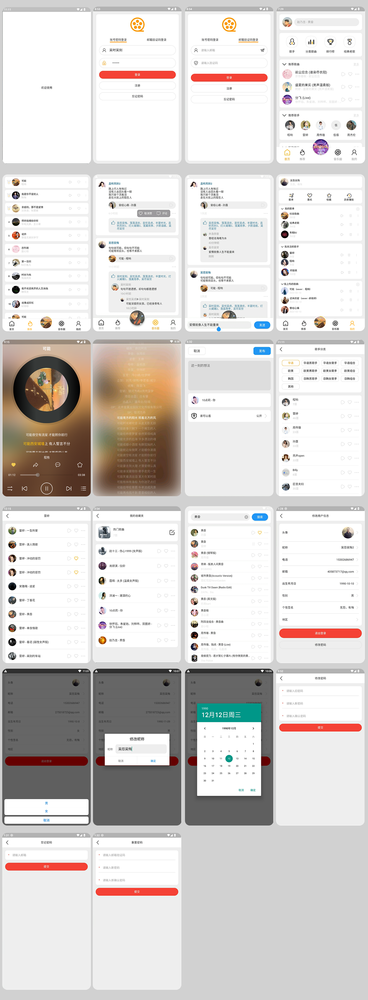
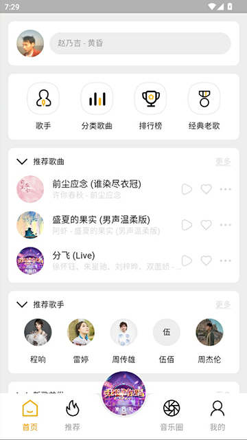
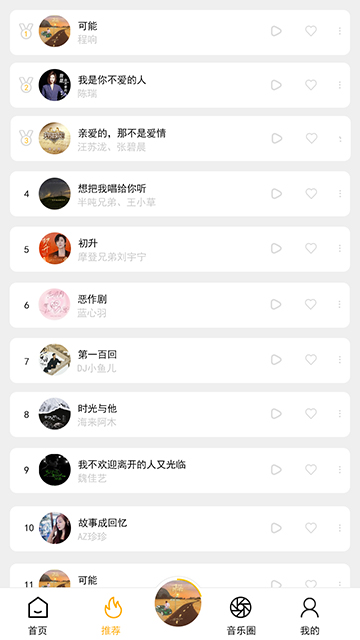
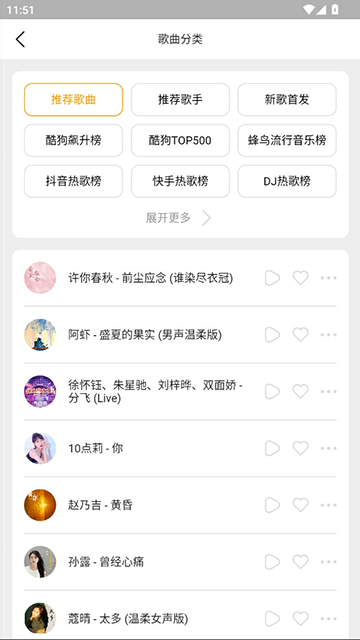
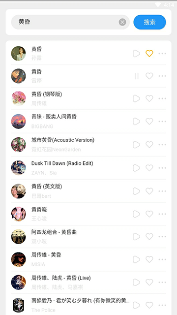
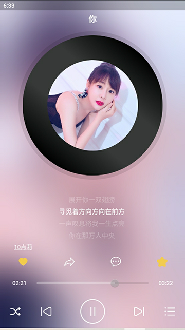
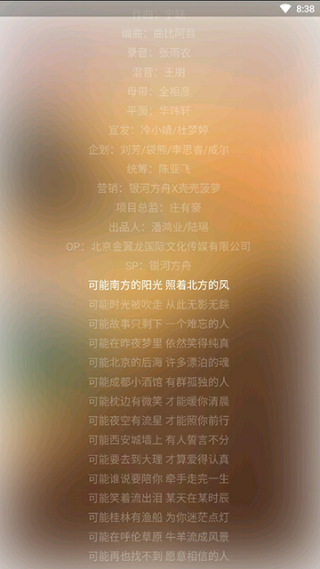
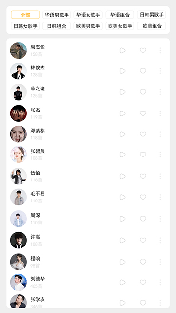
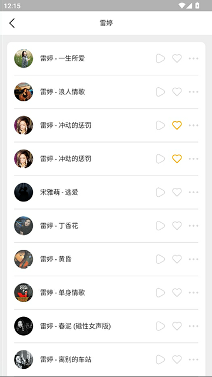

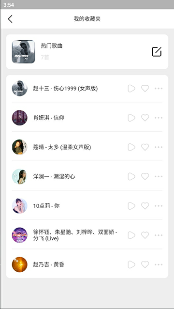


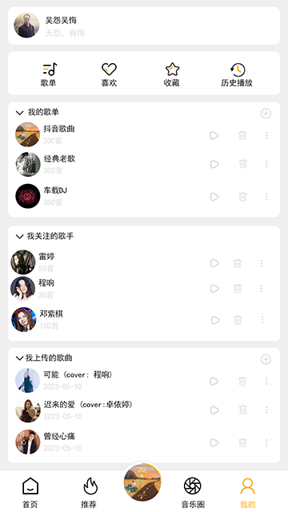
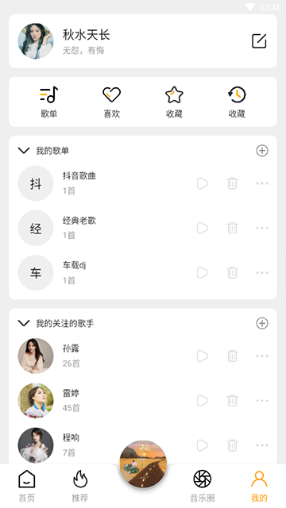
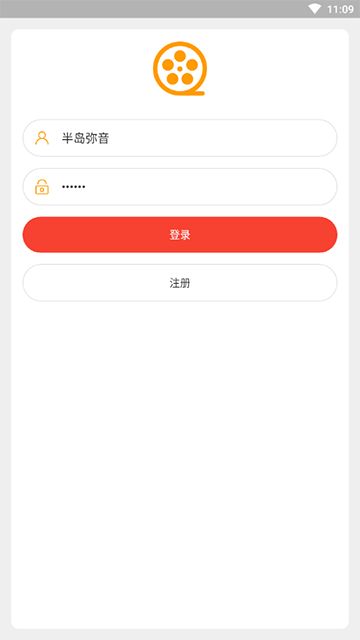
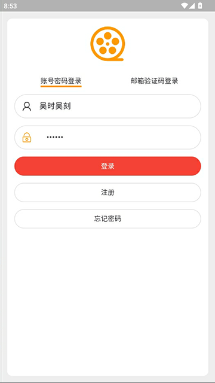
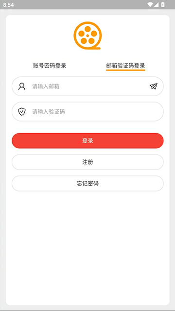
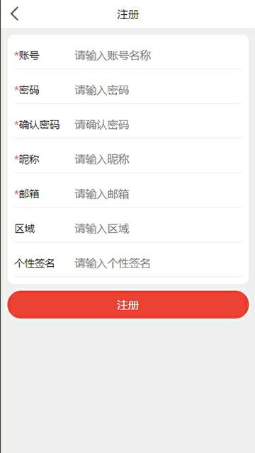
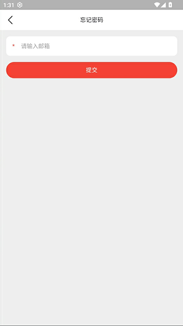
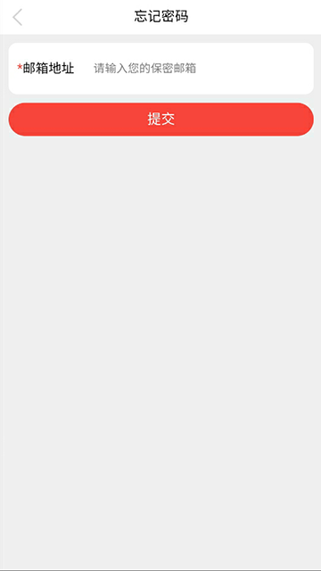
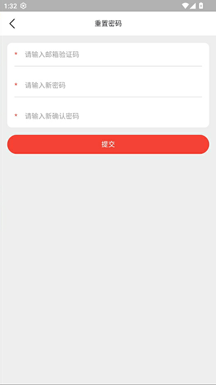
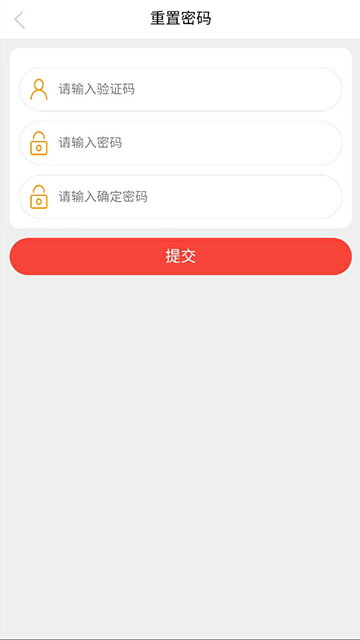
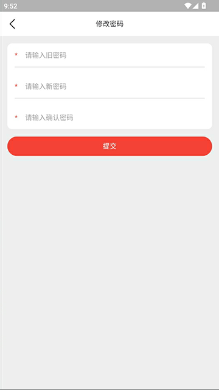

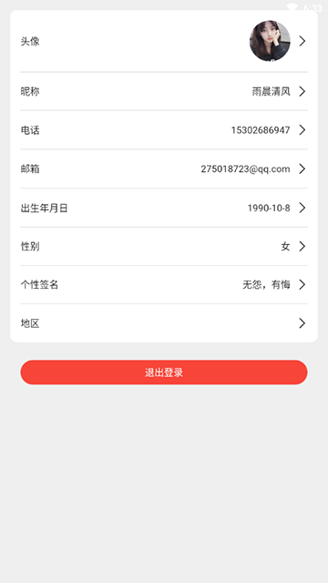
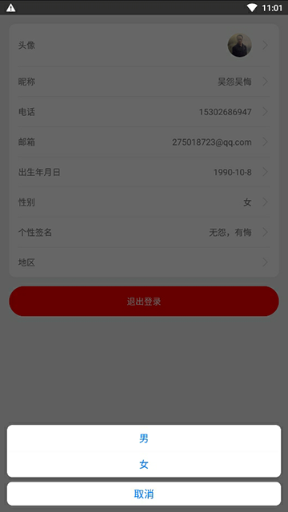
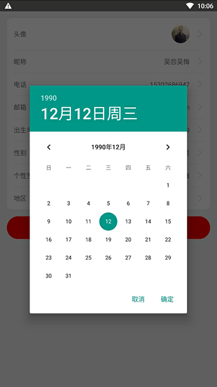
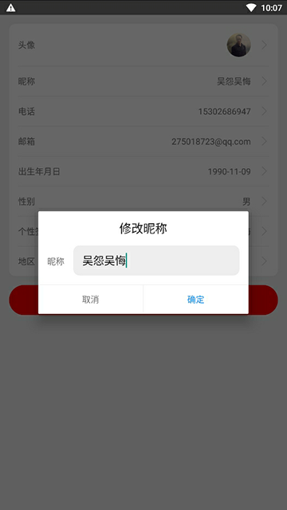
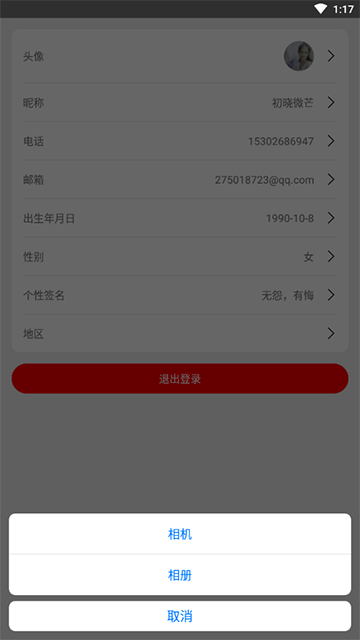
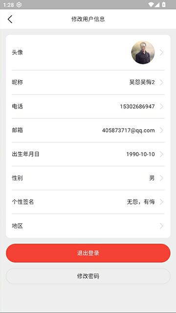

## 代码提交

```bash
# Gitee
./gitee-push.sh

# GitHub
./github-push.sh
```

- Gitee：https://gitee.com/wuyuanwuhui99/swift-music-app
- GitHub：https://github.com/wuyuanwuhui999/swift-music-app

欢迎 Star / Fork，期待协作共建！ 🎵
